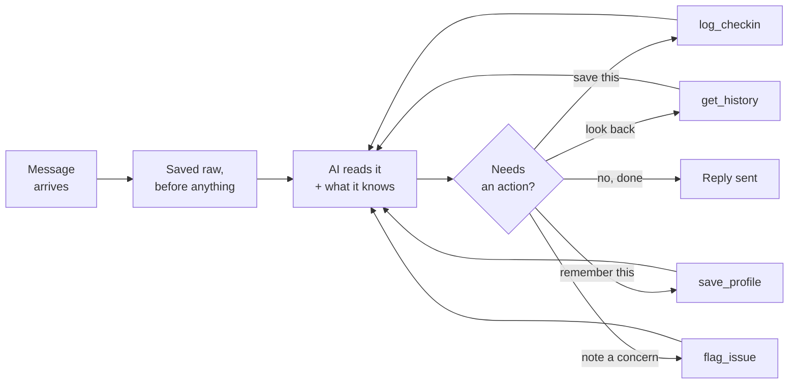

# Fitness Bot v2: Full Spec in Plain English

Sep 23, 2026 · @Someone

## What this is

A fitness coach that lives inside Telegram. You send it a short message each morning and evening about how you slept, what you weigh, and what you trained. It saves that, and replies like a coach would: one specific thing to do today, based on your own history.

It is not a food diary. It does not show you charts. The point is the reply.

**Who it is for**

|  |  |
| --- | --- |
| **Launching to** | Clients of one personal trainer in Singapore, roughly 10 to 20 people |
| **Designed for** | Someone with no trainer at all. Every safety rule assumes nobody else is watching |
| **Why both** | The trainer is how the first users arrive. But if the bot is only safe because a human is checking it, it is not safe |

**What it is really for**

This is a portfolio project. The goal is to prove one thing in a job interview: that the person who built it can ship an AI agent with real users and real guardrails, and explain every decision in it. Ten to twenty users who keep using it is the target. Not a business.

**What is built today**

Nothing of this version. There is an older, simpler bot from April that works for one person. This document describes the rebuild, which is designed but not yet written.

## Glossary

Every term used in this document, in plain English.

**The AI bits**

| Term | What it means |
| --- | --- |
| **LLM** | Large Language Model. The AI that reads text and writes text back. Claude and ChatGPT are LLMs |
| **Model** | The specific version of the AI being used. Haiku is small, fast and cheap. Sonnet is bigger, slower and better at hard thinking |
| **Prompt** | Everything you send the AI: the instructions, the background facts, and the user's message |
| **System prompt** | The standing instructions that never change. The personality and the rules |
| **Context** | All the text the AI can see on one call. It has no memory between calls, so anything it needs must be in there |
| **Token** | How text is counted and billed. Roughly ¾ of a word. A 100-word reply is about 130 tokens |
| **API call** | One request to the AI. You send text, you get text back. Each one costs money |
| **Hallucination** | The AI confidently stating something untrue. Usually because it was guessing instead of being told |

**Agent terms**

| Term | What it means |
| --- | --- |
| **Agent** | An AI that can choose actions, not just write text. It decides what to do, does it, sees the result, and decides again |
| **Tool** | One action the agent is allowed to take, like "save a check-in". The agent asks for it. Your code performs it |
| **Tool schema** | The written description of a tool: its name, when to use it, what goes in, what comes back. This is what the AI reads when choosing |
| **Agent loop** | The repeating cycle: AI decides, code acts, result goes back to the AI, repeat until the AI has an answer |
| **Workflow** | Fixed steps that run the same way every time. The opposite of an agent. The old bot is a workflow |
| **Guardrail** | A rule the AI cannot break, because code enforces it rather than the prompt requesting it |
| **Eval** | A test for an AI. A set of example messages with the right answers, so you can check the bot still behaves after a change |

**The plumbing**

| Term | What it means |
| --- | --- |
| **Database** | Where information is stored. Like a set of spreadsheet tabs, but faster and built for many users |
| **Table** | One tab. `users` is one table, `checkins` is another |
| **Row** | One entry. One person, or one check-in |
| **Column** | One field on every row. `weight_kg` is a column |
| **Schema** | The shape of the database: which tables exist and what columns they have |
| **Migration** | Changing the shape after data already exists. Fiddly, which is why the schema is worth getting right early |
| **Postgres** | The database being used. Good for many users at once |
| **Webhook** | The address Telegram sends messages to when someone texts the bot |
| **Railway** | The service that runs the bot on the internet |
| **Environment variable** | A secret (like a password or API key) kept outside the code, so it never ends up on GitHub |

**Product terms**

| Term | What it means |
| --- | --- |
| **Retention** | How many people are still using it after a period. "Day-30 retention" means still active a month later |
| **Churn** | People stopping. The opposite of retention |
| **Friction** | Anything that makes a user do more work. More friction means more churn |
| **PDPA** | Singapore's personal data law. Covers consent, keeping data only as long as needed, and protecting it |
| **PII** | Personally Identifiable Information. Anything that ties data to a real person: name, email, phone |

## Why it exists

**The problem for the person training**

Logging apps take effort and give back a number. You fill in a food diary and it says 1,847. It does not tell you what to do. Meanwhile a personal trainer sees you twice a week and has no idea what happened on the other five days.

**The problem for the trainer**

Twenty clients, and no visibility between sessions. "How was your week?" gets "yeah, pretty good." They find out someone has been sleeping five hours and skipping meals three weeks too late.

**What the bot does about it**

| Audience | What they get |
| --- | --- |
| Client | Type ten seconds of text, get one specific instruction based on their own history |
| Trainer | One sheet showing who logged, who went quiet, and who needs a message this week |

Both come from the same engine. The bot notices something, then tells the client one way and the trainer another.

### Why not just use ChatGPT or Claude

This is the most important question, and only two answers hold up.

**1. It speaks first.**

ChatGPT waits for you to open it. It structurally cannot start a conversation. A coach does not wait. A message arriving unprompted that says "third short night in a row, today goes light" is a different product from you remembering to go and ask. Most people never remember to go and ask. That is why food diaries die.

**2. Its arithmetic is right.**

Ask a general chatbot "what is my average sleep on gym days versus rest days over two months" and it is working from a fuzzy memory of a conversation. It will give a confident number that may be wrong. This bot keeps the numbers in a database and has plain code do the maths. The number is right every time.

**Everything else is not a difference.** Memory, personalisation, tone, quality of advice: general chatbots do all of that now, and the gap is closing. The pitch should not rest on them.

### What people actually pay for

Not tracking. Free trackers already exist. People pay for accountability, which in practice means *someone notices*. That is the same thing as point 1, which is a good sign the product is aimed at the right place.

### Keeping people logging

This is the real risk, and there are numbers for it.

| Measure | Figure |
| --- | --- |
| Average fitness app, still active at day 30 | 3 to 4% |
| Best-in-class at day 30 | 25% |
| Installs that never come back after the first session | 70 to 80% |
| Users who quit within 100 days | 70%, steepest in the first two weeks |

So keeping 4 or 5 people out of 20 active at day 30 would be a strong result.

| Why people quit | How this build handles it |
| --- | --- |
| Logging is tedious | No app to install, no forms. One line of text |
| Onboarding is a slog | Seven questions, answered with buttons |
| Advice is generic | The whole point of the profile and memory |
| Privacy feels murky | Consent up front, and a delete command |
| Results are slow | Nothing in software fixes this. Show an insight in week 1 instead |

### The honest weak spots

1. **This is a feature, not a company.** Any established app could build the same noticing engine in a sprint.
2. **Telegram is not where Singapore is.** WhatsApp is. Telegram was chosen because it is easier to build on.
3. **Who pays is unclear.** Chat-based AI coaches already exist at around $30 a month. Trainer software already costs $108 to $137 a month at 25 clients.
4. **There is no moat at 20 users.**

All true, and all fine, because the goal is a portfolio piece, not a business. Being able to state these clearly is itself worth something in an interview.

## How it works

### The difference between a workflow and an agent

**A workflow** runs the same steps every time. The old bot did this: split the message on commas, work out the streak, paste the history into a prompt, make one AI call, send the reply. The AI sat at the end and wrote text. It decided nothing.

**An agent** lets the AI choose. It reads the message, decides what needs doing, does it, looks at the result, and decides again. Two different messages take two different paths.

### The loop



### What actually happens, step by step

Someone sends **"82kg, slept 6h, legs today"**.

| Step | Who | What happens |
| --- | --- | --- |
| 1 | Code | Saves the raw text immediately. Nothing can be lost after this point |
| 2 | Code | Looks up who sent it, and loads only their records |
| 3 | Code | Builds the background facts: streak, weight change, sleep run |
| 4 | **AI** | Reads the message and the facts. Replies: "use `log_checkin` with weight 82, sleep 6, training legs" |
| 5 | Code | Checks it, writes the row, hands back the updated numbers |
| 6 | **AI** | Reads the result and writes the coaching reply |
| 7 | Code | Sends it to Telegram |

That is two AI calls for one check-in. The AI never touches the database. It asks, and code decides whether to agree.

### Which parts are AI, and which are code

This split is the core design idea. **AI where judgment is needed. Code where being right matters.**

| The AI decides | Code decides |
| --- | --- |
| What "slept badly, legs today" means | The streak, weight change, days since last check-in |
| Which action to take | What happens at each level of concern |
| Whether to ask about a missing field | Whether a calorie target is safe to accept |
| How serious a mention of pain sounds | Which user's data gets loaded |
| How the reply is worded | How long data is kept, and when it is deleted |

**Why it matters.** A rule written in a prompt is a request. The AI usually follows it, and occasionally does not, and nothing tells you when. A rule written in code happens every time. So anything that would be a real problem if skipped goes in code.

The classic failure this avoids: an important rule quietly not firing, with no error, no log line, and a reply that reads perfectly fine.

### Why not use a framework

Tools like LangGraph package this loop up for you. That is useful on big systems, but here the loop is about fifteen lines, and being able to explain it start to finish is the whole point of the project. Build it by hand first. Porting it to a framework afterwards is a small job, and the comparison makes a better interview answer than having used one from the start.

## The user journey

### 1. Joining

The trainer shares the bot's Telegram link. The client taps it and presses Start. Nothing to install and no account to create, because Telegram already knows who they are.

If they came from a trainer, that connection is set up by hand at first: one name typed into their record. Invite links can come later. At 20 users, doing it manually costs minutes and saves building a whole system.

### 2. Onboarding

First, a short privacy message and an agree button. It says what is collected, who can see it, and how to delete it. Nothing is stored before they agree.

Then seven questions, answered by tapping buttons where possible:

| Question | Why it is needed on day one |
| --- | --- |
| Name | To talk to them like a person |
| Age | Under 18 is blocked |
| Sex | Sets the minimum safe calorie level |
| Current weight | The baseline for every trend |
| Main goal | Lose fat, build muscle, perform, feel better. Shapes every reply |
| Injuries or health issues | The bot must know before it says anything about training |
| Trainer, if any | Links them to their coach |

**Deliberately not asked:** sleep patterns, water, current eating, activity level, training frequency. The bot learns all of that from the first week of check-ins. Every extra question at signup costs users.

**Also not asked:** height. It is only needed for calorie formulas, and the safety limit here is a fixed number rather than a formula.

**If they mention an injury,** onboarding continues. It is not a reason to stop. Their trainer sees it, or if they have none, the bot suggests getting it looked at before training hard.

### 3 and 4. The daily check-ins

Morning is weight, sleep, training, energy. Evening is training notes, food, water. Both are typed however the person likes: "82kg, slept badly, legs today" works.

| Situation | What the bot does |
| --- | --- |
| Some fields missing | Always saves what it got. Never refuses |
| Missing, and they are doing fine | Saves it, one short line: "no sleep logged, send it later if you want" |
| Missing, and they are struggling | Saves it and says nothing. Take what you can get |
| Already asked about that field today | Never asks twice |
| Second check-in the same day | Works out whether it is a correction or a new entry, and asks before changing anything |
| Backdating | "forgot yesterday" is understood |

**Why never refuse a partial log.** Making someone fill in everything turns a ten-second action into a conversation. That friction is the top reason people stop using tracking apps, and the weeks it bites hardest are the ones where most people quit.

### 5. When something looks off

The bot grades anything concerning into four levels. The AI decides the level. Code decides what happens.

| Level | What it looks like | What happens |
| --- | --- | --- |
| Green | Normal training aches | Nothing |
| Yellow | Mild, mentioned once | Noted, checked next time |
| Orange | Real pain, or repeated, or in a known injury area | Flagged for the trainer. Suggests going lighter |
| Red | Shooting pain, numbness, weakness | Recommends a doctor. Stops giving training advice until they say they have been cleared |

With no trainer, the bot says it directly instead of flagging. Every flag is recorded either way.

### 6. Asking about the past

"How has my sleep been this month?" The bot fetches the data and answers. Up to 90 days. Anything outside what the bot does gets a polite redirect.

### 7. Things that change

"Hurt my knee." "New calorie target." The bot proposes the change and the person confirms before anything is saved. The old value is kept.

### 8. The trainer's view

One Google Sheet per trainer, showing all their clients: check-ins on one tab, flags on another. View-only, shared with that trainer alone. Clients never see it.

### 9. Going quiet, and the bot speaking first

This is the part that makes it a coach rather than a chatbot, and it is deliberately not designed yet. The right thresholds are much easier to judge after two weeks of real use than before day one.

## The database

Think of it as a spreadsheet with seven tabs. Each tab is a **table**. Each line in a tab is a **row**. Each field is a **column**.

This is the part worth getting right before building. Changing the shape later, once real data exists, is fiddly. Prompts and thresholds can be changed in seconds.

### `users` — one row per person

| Column | Example | What it is for |
| --- | --- | --- |
| `user_id` | 17 | The internal number for this person |
| `telegram_chat_id` | 88213… | Which Telegram chat is theirs. Replaces the old bot's single hardcoded chat |
| `name` | Priya | First name only |
| `age` | 29 | Under 18 is blocked |
| `sex` | F | Sets the minimum safe calorie level |
| `coach_id` | 3, or empty | Empty means no trainer |
| `coach_consent` | true | They agreed their trainer can see this |
| `consent_given_at` | 23 Sep, 10:14 | Proof they agreed, and when |
| `joined_at` | 23 Sep | Needed to measure retention |
| `last_active_at` | 23 Sep | Drives the deletion rule |

### `profiles` — the long-term picture

| Column | Example |
| --- | --- |
| `goal` | lose fat |
| `start_weight` | 64kg |
| `calorie_target` | 1,800, or empty |
| `protein_target_g` | 120 |
| `targets_set_by` | user, or coach |
| `disciplines` | gym, running |

### `issues` — things that must not get buried

| Column | Example |
| --- | --- |
| `what` | lower back, surgery last year |
| `status` | active, or resolved |
| `first_mentioned` | 23 Sep |

Active issues are loaded into every reply. An injury mentioned once in week two should not be forgotten in week six.

### `checkins` — one row per check-in

| Column | Example |
| --- | --- |
| `date` | 24 Sep |
| `entry_type` | morning, or evening |
| `weight_kg` | 63.8 |
| `sleep_hours` | 6 |
| `training` | legs |
| `energy` | 3 |
| `calories` | 1,850 |
| `protein_g` | 165 |
| `water_l` | 2.5 |
| `raw_message` | "63.8, slept 6h, legs today" |
| `corrected_at` | empty, or a timestamp |

`raw_message` matters more than it looks. It keeps exactly what the person typed. If the AI misreads something, you can see why and fix it later without losing anything. It is also the record used to test the bot's behaviour in the next build.

### `flags` — anything the bot was concerned about

| Column | Example |
| --- | --- |
| `date` | 24 Sep |
| `level` | orange |
| `type` | pain, eating, sleep, target |
| `note` | "back pain after deadlifts, second time this week" |
| `quote` | the person's own words |
| `action_taken` | "suggested lighter session, shown to coach" |

### `coaches` and `usage_log`

`coaches` holds each trainer and the link to their sheet. `usage_log` records each AI call and what it cost, which is how the daily limit is enforced and how cost per user gets measured.

### How long data is kept

| Situation | What happens |
| --- | --- |
| Still using it | Everything kept |
| No check-in for 6 months | One warning message, then deleted |
| They type `/delete` | Everything wiped immediately |

Singapore's PDPA says personal data should not be kept longer than there is a reason to keep it. Weight, food and pain are sensitive, so a clear rule matters.

## What the bot knows on every turn

An AI has no memory between calls. Each time you talk to it, it starts from nothing. So anything it needs to know has to be written into the message you send it. That bundle is called the **context block**.

Code assembles it every single time. The AI never has to remember to go and look something up, because it is already there.

### What goes in

| Part | Where it comes from | Why it is always there |
| --- | --- | --- |
| The rules and personality | A fixed file | Never changes |
| Their profile | `profiles` | Goal and targets shape every reply |
| Active injuries | `issues` | Must never be buried in old messages |
| Calculated facts | Plain code | Anything a rule depends on |
| The last 3 days | `checkins` | Short, and useful nearly every time |
| Anything the bot is waiting on | `pending` | Whether it asked a question last time |

### The calculated facts

These are worked out by ordinary code, not by the AI.

| Fact | Example | What it drives |
| --- | --- | --- |
| `streak` | 12 of last 14 | Only mentioned when it means something |
| `days_since_last_checkin` | 1 | Whether to welcome them back |
| `days_since_joined` | 4 | Be gentler in week one |
| `weight_change_7d` | down 0.4kg | The trend, and the fast-loss warning |
| `short_sleep_streak` | 2 | The sleep rule |
| `logged_today` | morning yes, evening no | Handling a second message |
| `already_asked_today` | energy | Never ask twice |
| `user_state` | normal, or struggling | Whether to mention a missing field at all |

**Why calculate these instead of letting the AI work them out?** Because the AI would sometimes get it wrong, and nothing would tell you. If the sleep run is handed over as the number 2, it cannot be miscounted and it cannot be overlooked.

**`user_state` is one word doing a lot.** Code decides whether someone is coping or struggling, based on missed days, low energy, and short logs. The AI then knows whether to push or back off. All the logic lives in code, so it is consistent and testable.

### What it actually looks like

```markdown
PROFILE
First name: Priya. Goal: lose fat.
Trains: gym, running. Targets: 1,800 cal, 120g protein (set by user).

ACTIVE ISSUES
Lower back, surgery last year. Active since 12 Sep.

WHERE THEY ARE
Streak: 12 of last 14. Day 23 since joining.
Weight: down 0.4kg over 7 days.
Short sleep: 2 nights running.
Today: morning not logged, evening not logged.
State: normal.

LAST 3 DAYS
21 Sep  63.9kg  5.5h  legs
22 Sep  63.8kg  5.5h  rest
23 Sep  not logged

WAITING ON
Nothing.
```

Roughly 200 to 300 tokens. That is the standing cost of the bot knowing who it is talking to.

### What is deliberately left out

| Left out | Why |
| --- | --- |
| Full history | That is what the `get_history` tool is for |
| Telegram id, full name, email | The AI does not need identifiers to coach well. Less sent overseas, less to leak |
| Old flags | Only current issues matter for today's reply |
| Anything about another person | Code loads one user's records, so a mix-up is not possible |

Sending a first name is fine and makes the reply read like a person wrote it. Sending anything that ties the data back to a real identity is not.

## The four tools

A **tool** is one action the AI is allowed to take. Think of a filing clerk with a stack of blank forms. Each form has a title, a note saying when to use it, and blanks to fill in. The clerk never opens the filing cabinet. They fill in a form and hand it over, and someone else does the filing.

Every tool has four parts:

| Part | What it is |
| --- | --- |
| Name | What the AI calls it |
| When to use | One or two sentences. The only thing the AI reads when choosing, so it is really a small prompt |
| Inputs | The blanks on the form |
| Returns | What gets handed back, which the AI reads before writing its reply |

The **returns** are where a lot of the behaviour lives. If a tool hands back "saved, and the streak is now 12", the AI can mention the streak. If it hands back "refused, that target is below the safe minimum", the AI has to tell the person. That is how a rule in code reaches the conversation.

### 1. `log_checkin`

**When to use:** the person is reporting how they are doing today or yesterday. Use it even if only one value is given. Do not use it when they are only asking a question about the past.

| Input | Type | Required |
| --- | --- | --- |
| `entry_type` | morning or evening | Yes |
| `date` | today or yesterday | No, defaults to today |
| `weight_kg` | number | No |
| `sleep_hours` | number | No |
| `training` | text | No |
| `energy` | 1 to 5 | No |
| `calories` | number | No |
| `protein_g` | number | No |
| `water_l` | number | No |
| `is_correction` | true or false | No, defaults false |

**Returns:** whether it saved, what was saved, the updated streak, weight change, sleep run, days since the last check-in, which fields were missing, and whether there is already an entry for today.

Those numbers are recalculated after saving, so the reply is based on the current picture rather than the one from before the message arrived.

### 2. `get_history`

**When to use:** the person is asking about their past. A trend, an average, how a period went. Not for a normal check-in.

| Input | Type | Required |
| --- | --- | --- |
| `days` | 1 to 90 | Yes |
| `fields` | e.g. sleep and weight only | No |

**Returns:** up to 14 days comes back as individual days. Longer than that comes back as weekly averages plus the last 7 days in full. It also says how much data actually exists, so someone on day three asking about their month gets "only 3 days available" rather than an invented trend.

The averages are calculated in code. The AI reads numbers, it does not work them out.

### 3. `save_profile`

One tool for both onboarding and later changes, because they write to the same place.

**When to use:** you have learned something lasting: a name, age, goal, injury, trainer, or target. Not for a single day's numbers, which is a check-in.

| Input | Notes |
| --- | --- |
| `name`, `age`, `sex` | Code blocks under 18 |
| `goal` | Lose fat, build muscle, perform, feel better |
| `disciplines` | Gym, running, Muay Thai |
| `calorie_target` | **Code checks it against the safe minimum and can refuse** |
| `protein_target_g` |  |
| `issue` | An injury. Creates a row in `issues` |
| `coach` | Blank means no trainer |
| `user_confirmed` | Must be true to change something already saved |

**Returns:** what was saved, what was refused and why, and during onboarding, which question comes next.

### 4. `flag_issue`

This one changes nothing about the person's data. It records what the AI concluded, so code can act on it.

**When to use:** they have mentioned pain, an injury, or something about their eating or training worth recording. Report what you saw and how serious it looks. Do not decide what happens next.

| Input | Notes |
| --- | --- |
| `level` | yellow, orange or red |
| `type` | pain, eating, sleep, target, other |
| `note` | What was observed, in a sentence |
| `quote` | Their own words, for the record |

**Returns:** what the system has decided to do, so the AI knows what to say. For example: "recorded as orange, trainer will see it, tell them to keep today light and see a physio if it continues."

This is the split in action. The AI judges how serious something sounds. Code decides the consequence.

### Why four and not more

Every extra tool costs tokens on every single call and adds another chance to pick the wrong one. The test: can you write a "when to use" line for each that does not overlap any other? If two need almost the same sentence, they should be one tool.

That is why morning and evening check-ins are one tool with a field, not two tools. And why saving a profile and updating one are the same tool.

## Keeping it safe and cheap

### The safety rules

Every one of these is enforced by code, not requested in a prompt.

| Rule | With a trainer | With no trainer |
| --- | --- | --- |
| Under 18 | Blocked | Blocked |
| A calorie target below the safe minimum | Refused, trainer told | Refused, suggests a doctor or dietitian, carries on with no calorie target |
| Injury mentioned at signup | Continue, trainer sees it | Continue, suggest a physio check before training hard |
| Mild concern, once | Noted | Noted |
| Real pain, repeated, or in a known injury area | Flagged, suggest going lighter | Said directly, suggest a physio if it continues |
| Shooting pain, numbness, weakness | Doctor, flagged, no more training advice | Doctor, no more training advice until they say they are cleared |

The safe minimum is a fixed number by sex, roughly 1,200 for women and 1,500 for men. A simple fixed limit was chosen over a clever formula because the cost of getting it wrong is high and it is easier to explain and test.

**Why Red is rare on purpose.** If ordinary aches triggered the most serious response, people would hit it every other week, learn to ignore it, or stop mentioning pain so the bot stops nagging. Then when a real one comes, it does not land. Flagging too much is a safety problem too.

### Rules in code, not in prompts

The other bot wrote its rules into the prompt and hoped. That mostly works, and occasionally does not, and nothing tells you when. Here the important ones sit in code:

| Rule | Where it lives |
| --- | --- |
| Calorie floor | Code. `save_profile` refuses and says why |
| Under 18 | Code. Onboarding stops |
| What happens at each concern level | Code. `flag_issue` returns the decision |
| Only your own data loads | Code. The AI never sees another person's records |
| Data deletion | Code, on a schedule |

### Privacy

Singapore's PDPA sets out what is expected of anyone handling personal data. Here is how each part is handled. This is a sensible starting point rather than legal advice.

| What the law asks | What the bot does |
| --- | --- |
| Tell people what you collect, get their agreement | Privacy message and an agree button before anything is stored |
| Only collect what you need | Seven questions, no nice-to-haves |
| Let people see and correct their data | `/mydata` shows everything stored. Corrections are supported |
| Do not keep it longer than needed | Deleted after 6 months inactive. `/delete` wipes it immediately |
| Protect it | Secrets kept out of the code, only your own records load, trainer's sheet is view-only |
| Care about data going overseas | The app and database sit in Singapore. Only the AI calls leave the country |
| Be contactable | A contact email in the privacy message |

**Where the data lives**

| Place | What goes there |
| --- | --- |
| Railway, Singapore region | The app and the database. Stays in Singapore |
| Anthropic | Only what is in the context block, briefly, for each AI call. No identifiers |
| Telegram | The messages themselves, as with any chat app |
| Google Sheets | The trainer's view of their own clients |

All four belong in the privacy message.

**Design rule:** send the AI the least it needs. It never needs a Telegram id or a full name to give good coaching.

### Keeping the cost under control

| Control | Setting | Why |
| --- | --- | --- |
| Tool calls per message | Max 4 | A check-in is 1, a question is 1, the worst realistic case is 3. Stops a loop spinning |
| Messages per person per day | Max 40 | Normal use is 2 to 4. Ten times headroom, and stops abuse |
| Model | Haiku for check-ins | Short, frequent, cheap. Sonnet only for the weekly summary |
| Spending cap | Set on the Anthropic workspace | The real backstop, and it must exist before the first call |

### When something breaks

| Failure | What the person sees |
| --- | --- |
| AI is down | "Logged. Coaching didn't come through, try again in a bit." Their data is already saved |
| AI writes coaching but forgets to save | Code notices and runs it again, insisting on the save |
| Still fails | The raw message is stored anyway and flagged for review |
| Tool limit reached | Replies with what it has, and logs a warning |

**The single most useful safeguard:** the raw message is saved the instant it arrives, before the AI runs at all. Whatever else goes wrong, the person's data exists. It is also the record used to test the bot's behaviour later.

## What changed, and what is left

### Version 1, built in April

A Telegram bot for one person. You sent `98.5, 7, MT sparring, 4` in exactly that format. It saved the row to a Google Sheet, worked out the streak, pasted the last four days into a prompt, made one AI call, and sent back a reply. The person's weight, targets and habits were typed directly into the prompt file. It replied to one hardcoded chat.

It worked, and for one user it was the right amount of machinery.

### Version 1 to version 2

|  | Version 1 | Version 2 |
| --- | --- | --- |
| Users | One | Many, each with their own profile |
| Typing | Exact format or an error | Normal language |
| What it knows about you | Typed into the prompt file | Stored per person, updated over time |
| History | Last 4 days pasted every time | Key facts calculated and always included. More fetched only when asked |
| Decisions | None. The same two steps every time | Chooses what to do |
| Safety | Rules written in the prompt | Code enforces the ones that matter |
| Speaks first | Never | The core feature, once built |
| Setup | Edit the code | The bot interviews new people |
| Storage | One Google Sheet | Postgres, one record per person |
| If it breaks | Data lost | Raw message saved before anything else runs |

### What was wrong with version 1, found by reading the code

| Problem | Status |
| --- | --- |
| The prompt file with personal details was on a public GitHub repo, despite a comment in the file saying to keep it off GitHub | Repo made private. Exposed from April to September. No passwords in it |
| The bot never checked who sent a message, and always replied to one chat | Fixed by design in v2: messages are routed by sender |
| The webhook was open to the internet, no password, no rate limit, and every request cost money | v2 adds a shared secret and a rate limit |
| Raw messages, including weight and sleep, were written to the server logs | v2 logs an event and a user number, never the message |
| A Google credentials file was once committed to the public repo | New key created. Old one still needs deleting in Google Cloud, not just replacing |

### What is decided but not built

Everything in this document is design. None of version 2 exists yet.

The first thing to build is one narrow slice, end to end: signing up and a morning check-in, for one person, with a real database and a real agent loop. Then use it for two days. That will surface three things this design got wrong, which is normal, and it is a better way to find them than more planning.

### Still open

| Question | Why it is waiting |
| --- | --- |
| When the bot should message someone first, and how often | The most important feature, and much easier to judge after two weeks of real use |
| What counts as worrying eating, or a sudden weight drop | Needs weeks of data before it can even trigger |
| Whether anything should be shown for a weekly summary | Better decided once daily replies feel right |
| Whether WhatsApp is worth the extra work | Depends on whether Telegram actually puts people off |

### After that

The second build is a test suite: a set of example messages with the right answers, run after every change, so you can prove the rules still fire. Every rule in this document is a test case. That is also the honest answer to "how do you know your agent works", which is the question this whole project exists to be able to answer.
